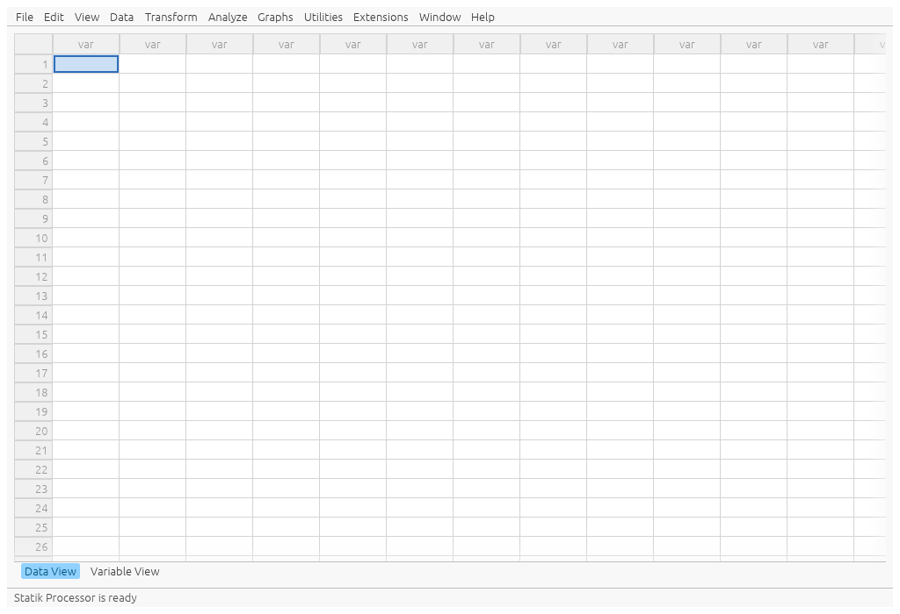
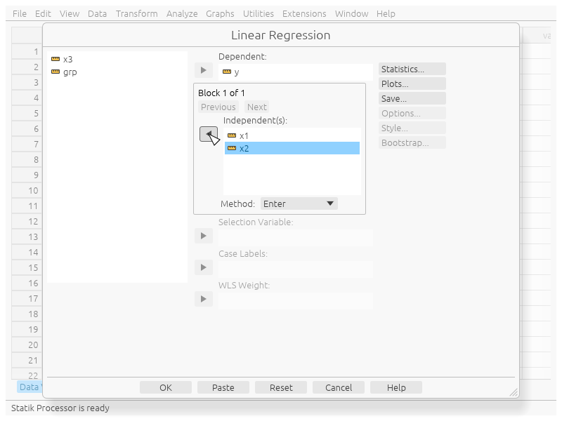
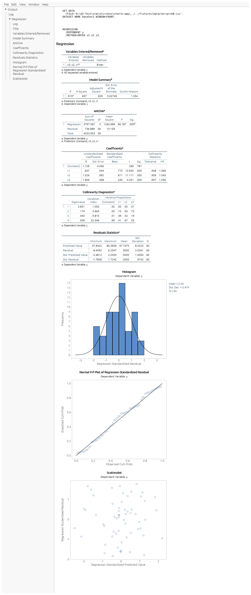
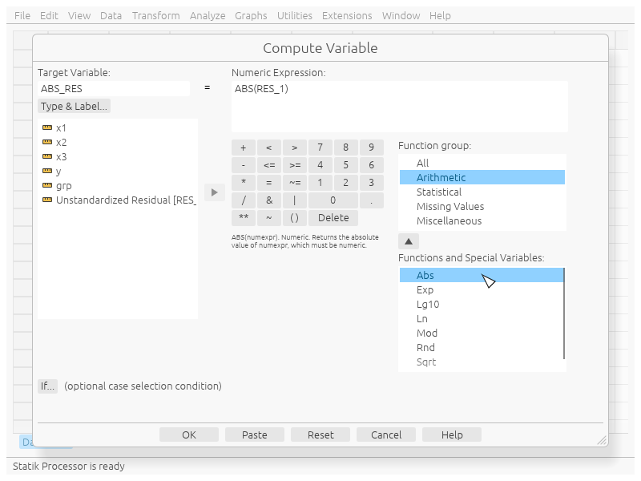

# Statik

**Statik** adalah aplikasi statistik desktop yang ringan untuk Windows 10/11, dibuat untuk
mahasiswa yang mengerjakan tugas kuliah atau skripsi. Alur kerjanya dibuat mirip SPSS supaya
tidak perlu belajar ulang:

- isi data di **Data Editor** (Data View dan Variable View),
- pilih analisis dari menu **Analyze**,
- baca hasilnya di jendela **Output**, lalu salin tabelnya langsung ke Word.

Cukup satu berkas `Statik.exe` (sekitar 11 MB). Tidak perlu instalasi atau lisensi, dan
aplikasinya terbuka dalam kurang dari 1 detik.

> Statik bukan produk IBM dan tidak berafiliasi dengan IBM SPSS Statistics. Statik bisa
> membuka dan menyimpan berkas data `.sav`, dan mengimpor CSV serta Excel.



## Daftar isi

- [Fitur Tahap 1](#fitur-tahap-1)
- [Menjalankan Statik](#menjalankan-statik)
- [Tutorial: regresi linear berganda dan uji asumsi klasik](#tutorial-regresi-linear-berganda-dan-uji-asumsi-klasik)
- [Uji t dan analisis lain](#uji-t-dan-analisis-lain)
- [Menyalin tabel ke Word](#menyalin-tabel-ke-word)
- [Kirim masukan](#kirim-masukan)
- [Keterbatasan](#keterbatasan)
- [Untuk pengembang](#untuk-pengembang)

## Fitur Tahap 1

| Bagian | Isi |
|---|---|
| **Data Editor** | Data View dan Variable View (Name, Type, Width, Decimals, Label, Values, Missing, Columns, Align, Measure, Role). Undo/Redo (Ctrl+Z / Ctrl+Y). Copy-paste blok sel dengan Excel. Tetap lancar sampai 100.000 baris. |
| **File** | Buka dan simpan `.sav`. Impor CSV dengan pratinjau, termasuk CSV dari Excel Indonesia (pemisah `;`, desimal `,`). Impor Excel `.xlsx` (pilih sheet). |
| **Transform** | Compute Variable (fungsi ABS, SQRT, LN, MEAN, SUM, LAG, dan lainnya, plus kondisi *If*). Recode into Different Variables. |
| **Analyze ▸ Descriptive Statistics** | Frequencies, Descriptives (termasuk simpan Z-score), Explore (uji normalitas Kolmogorov-Smirnov Lilliefors dan Shapiro-Wilk, Normal Q-Q Plot). |
| **Analyze ▸ Compare Means** | One-Sample T Test, Independent-Samples T Test (dengan uji Levene), Paired-Samples T Test, One-Way ANOVA. |
| **Analyze ▸ Regression ▸ Linear** | Model Summary dan Durbin-Watson, ANOVA (uji F), Coefficients dengan Tolerance/VIF, Collinearity Diagnostics, Residuals Statistics. Grafik histogram residual, Normal P-P Plot, scatterplot ZPRED–SRESID. Simpan residual dan nilai prediksi. |
| **Analyze ▸ Nonparametric Tests ▸ Legacy Dialogs** | 1-Sample K-S (dengan koreksi Lilliefors seperti SPSS versi terbaru) dan Runs Test. |
| **Output** | Tabel bergaya pivot SPSS lengkap dengan footnote, grafik, panel outline. Copy ke Word (tabel tetap menjadi tabel), Copy as Image, simpan dan buka output (`.stko`). |
| **Keamanan data** | Autosave tiap 3 menit dan tawaran *Recover data?* setelah crash. Pertanyaan *Save contents…?* sebelum data atau output hilang. |
| **Paste** | Setiap dialog punya tombol **Paste** yang menampilkan syntax setara SPSS. |

Angka hasil analisis diuji otomatis terhadap nilai bersertifikat NIST dan pustaka statistik
Python (scipy/statsmodels). Format angkanya mengikuti SPSS, misalnya `.000`, `.912ᵃ` dan
`.200*`.

## Menjalankan Statik

1. Unduh `Statik.exe` dan simpan di folder mana saja, misalnya `Documents\Statik`.
2. Klik dua kali `Statik.exe`. Jendela **Statik Data Editor** terbuka dengan data kosong
   (`Untitled1`).
3. Buka data lewat **File ▸ Open ▸ Data...** (`.sav`, `.csv`, `.xlsx`). Untuk mengatur
   pemisah kolom dan desimal, gunakan **File ▸ Import Data ▸ CSV Data...** atau
   **Excel...**.
4. Simpan dengan **File ▸ Save** atau **Save As...** (format `.sav`).

Jika Windows SmartScreen menampilkan peringatan *"unrecognized app"*, pilih
**More info ▸ Run anyway**. Peringatan ini muncul karena berkasnya belum ditandatangani
secara digital.

### Perubahan yang belum disimpan, autosave dan recovery

- Saat Anda menutup jendela atau memilih **File ▸ Exit**, **New**, **Open** atau
  **Import** dan masih ada data yang belum disimpan, Statik bertanya
  *"Save contents of data editor to …?"*:
  - **Yes** menyimpan data dulu,
  - **No** membuang perubahan,
  - **Cancel** membatalkan perintah.
- Saat keluar, Statik juga bertanya *"Save contents of output viewer…?"* untuk hasil analisis
  yang belum disimpan.
- Data yang belum disimpan dicadangkan tiap 3 menit ke
  `%LOCALAPPDATA%\Statik\recovery\`. Jika Statik tertutup mendadak (listrik padam atau crash),
  saat dibuka lagi muncul *"Statik closed unexpectedly. Recover data?"*. Pilih **Recover**
  untuk membuka cadangan terakhir, lalu simpan dengan **Save As...**. Setiap jendela Statik
  memakai folder cadangannya sendiri.

## Tutorial: regresi linear berganda dan uji asumsi klasik

Contoh: variabel dependen `y`, variabel independen `x1`, `x2`, `x3`.

> Jendela Output tidak punya menu Analyze atau Transform. Untuk menjalankan analisis
> berikutnya, kembali ke Data Editor lewat **Window ▸ Data Editor**.

### 1. Regresi, multikolinearitas, autokorelasi, dan grafik normalitas

1. **Analyze ▸ Regression ▸ Linear...**
2. Pindahkan `y` ke **Dependent** dan `x1`, `x2`, `x3` ke **Independent(s)** dengan tombol panah
   (atau klik dua kali nama variabelnya).
3. **Statistics...**: **Estimates** dan **Model fit** sudah tercentang. Centang juga:
   - **Collinearity diagnostics**, untuk uji multikolinearitas (bebas multikolinearitas bila
     Tolerance > 0,10 dan VIF < 10);
   - **Durbin-Watson**, untuk uji autokorelasi.

   Klik **Continue**.
4. **Plots...**: pindahkan `*SRESID` ke **Y** dan `*ZPRED` ke **X** untuk scatterplot
   heteroskedastisitas. Centang **Histogram** dan **Normal probability plot** untuk normalitas
   residual secara grafik. Klik **Continue**.
5. **Save...**: centang **Residuals ▸ Unstandardized**. Klik **Continue**.
6. Klik **OK**. Tabel *Model Summary*, *ANOVA*, *Coefficients* dan grafiknya muncul di Output,
   dan variabel baru `RES_1` (residual) masuk ke data.





### 2. Uji normalitas Kolmogorov-Smirnov (residual)

1. **Analyze ▸ Nonparametric Tests ▸ Legacy Dialogs ▸ 1-Sample K-S...**
2. Pindahkan `RES_1` ke **Test Variable List**, pastikan **Normal** tercentang, lalu klik **OK**.
3. Lihat baris **Asymp. Sig. (2-tailed)**. Residual berdistribusi normal bila nilainya > 0,05.

### 3. Uji heteroskedastisitas Glejser

1. **Transform ▸ Compute Variable...**
2. Isi **Target Variable** dengan `ABS_RES` dan **Numeric Expression** dengan `ABS(RES_1)`.
   Klik **OK**.
3. **Analyze ▸ Regression ▸ Linear...**: isi **Dependent** dengan `ABS_RES` dan
   **Independent(s)** dengan `x1`, `x2`, `x3`. Hapus centang di **Save...** supaya tidak
   menambah residual baru. Klik **OK**.
4. Pada tabel *Coefficients*, tidak terjadi heteroskedastisitas bila **Sig.** setiap variabel
   independen > 0,05.



## Uji t dan analisis lain

- **Analyze ▸ Compare Means ▸ One-Sample T Test...**: membandingkan satu variabel dengan nilai
  uji (**Test Value**).
- **Analyze ▸ Compare Means ▸ Independent-Samples T Test...**:
  - pindahkan variabel ke **Test Variable(s)** dan variabel kelompok ke **Grouping Variable**;
  - klik **Define Groups...** dan isi kode kedua kelompok, misalnya `1` dan `2`;
  - baca baris *Equal variances assumed* bila Sig. *Levene's Test* > 0,05; jika tidak, baca
    baris *Equal variances not assumed*.
- **Analyze ▸ Compare Means ▸ Paired-Samples T Test...**: pilih pasangan variabel, misalnya
  `pretest` dan `posttest`.
- **Analyze ▸ Compare Means ▸ One-Way ANOVA...**: uji F untuk lebih dari dua kelompok, dengan
  uji homogenitas varians.
- **Analyze ▸ Descriptive Statistics ▸ Explore...**: centang **Plots... ▸ Normality plots with
  tests** untuk tabel *Tests of Normality* (Kolmogorov-Smirnov dan Shapiro-Wilk).

## Menyalin tabel ke Word

1. Di jendela Output, klik tabel atau grafik yang ingin disalin.
2. Klik kanan, pilih **Copy**, lalu tempel di Word dengan **Ctrl+V**. Tabel masuk sebagai tabel
   Word yang bisa diedit. Jika ditempel ke Excel atau Notepad, tabel masuk sebagai teks
   dengan tab.
3. Untuk menyalin sebagai gambar, pilih **Copy as Image**.

Simpan seluruh output dengan **File ▸ Save Output As...** di jendela Output (berkas `.stko`),
dan buka lagi dengan **File ▸ Open Output...**.

## Kirim masukan

Statik masih baru, jadi masukan dari pemakai sangat membantu. Jika menemukan:

- **bug** (aplikasi error, tertutup sendiri, atau tombol tidak berfungsi),
- **angka yang berbeda dari SPSS**,
- **tampilan yang berbeda dari SPSS** dan membingungkan,

laporkan lewat [GitHub Issues](../../issues) repo ini. Supaya cepat diperbaiki, sertakan:

1. langkah yang dilakukan (menu dan dialog apa saja yang dipakai),
2. screenshot output Statik, dan bila ada, screenshot output SPSS untuk data yang sama,
3. berkas datanya (`.sav`, `.csv` atau `.xlsx`) bila tidak rahasia.

Laporan beda angka dengan SPSS paling berharga, karena itu cara satu-satunya memastikan semua
jumlah desimal dan footnote benar-benar sama persis.

## Keterbatasan

- Statik baru mencakup prosedur yang paling sering dipakai untuk tugas kuliah dan skripsi.
  Menu lain tampil abu-abu.
- Angka selalu memakai titik desimal (`.200`) dan label berbahasa Inggris, tidak mengikuti
  pengaturan regional Windows.
- Beberapa detail tampilan (jumlah desimal per kolom, posisi footnote, baris Monte Carlo di
  1-Sample K-S) belum dicocokkan dengan screenshot SPSS asli.
- Tempel ke Word sudah diuji lewat format clipboard, tetapi belum dicoba langsung di Word.

Daftar lengkap keterbatasan dan perbedaan yang diketahui ada di
[KNOWN_GAPS.md](KNOWN_GAPS.md). Untuk hasil yang penting, cocokkan dulu dengan referensi
atau program lain bila ragu.

## Untuk pengembang

### Struktur proyek

| Folder | Isi |
|---|---|
| `crates/dataset` | Model data: variabel, value labels, missing values, operasi edit |
| `crates/stat-core` | Matematika murni: distribusi, OLS, Shapiro-Wilk, Lilliefors, uji t, ANOVA |
| `crates/procedures` | Prosedur ala SPSS (Regression, Explore, T-Test, ...) yang menghasilkan tabel output |
| `crates/output-model` | Model tabel/grafik dan format angka SPSS; render teks dan HTML |
| `crates/sav-io` | Baca/tulis `.sav`; impor CSV dan XLSX |
| `crates/transform` | Bahasa ekspresi Compute Variable dan Recode |
| `crates/statik-app` | Aplikasi desktop (egui): Data Editor, dialog, jendela Output |
| `crates/statik-cli` | Program terminal untuk menjalankan prosedur dari CSV/SAV |
| `fixtures/`, `tools/reference/` | Data uji dan skrip Python pembuat angka acuan |
| `docs/superpowers/` | Rancangan, rencana kerja dan keputusan selama pengembangan |

### Build dan tes

Butuh Rust (toolchain MSVC).

```bash
cargo test --workspace          # semua tes
bash tools/release.sh           # build rilis → dist/Statik.exe
```

Angka acuan untuk tes dibuat dengan `tools/reference/gen_refs.py` (Python 3.12 dengan numpy,
scipy, statsmodels, pandas dan pyreadstat; lihat `tools/reference/requirements.txt`).
Hasilnya sudah tersimpan di `fixtures/ref/`, jadi Python tidak perlu untuk menjalankan tes.

### Rencana Tahap 2

1. Correlate ▸ Bivariate dan Scale ▸ Reliability Analysis (uji validitas dan reliabilitas
   kuesioner).
2. Crosstabs dan Chi-Square, uji nonparametrik lain (Mann-Whitney, Wilcoxon, Kruskal-Wallis).
3. Regresi Stepwise/Backward, regresi moderasi, regresi logistik biner.
4. Ekspor output ke `.docx`/`.pdf`, Syntax Editor.

Urutannya akan disesuaikan dengan masukan dari pemakai.
